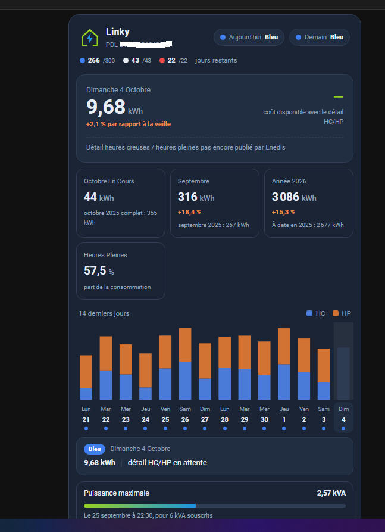

# Carte Enedis Linky New

[](https://buymeacoffee.com/marlboro62) [](https://ko-fi.com/nothing_one)

Cartes Lovelace pour **[MyElectricalData new](https://github.com/MyElectricalData/myelectricaldata_new)** (mode client), dans le style de l'interface MyElectricalData :

- **Carte Enedis Linky New** : consommation Linky, heures creuses / heures pleines, Tempo, coût estimé et puissance maximale ;
- **Carte Enedis Linky New · Production** (depuis la 0.3.0) : production, ou bilan des échanges avec le réseau (injecté / soutiré), pour les installations solaires ;
- **Carte Enedis Linky New · Tempo** (depuis la 0.5.0) : mini-carte sur une ligne, couleur Tempo du jour et du lendemain et jours restants.



🎮 **[Essayer la démo en ligne](https://marlboro62.github.io/content-card-linky-new/docs/demo.html)** : les vraies cartes (consommation, production, bilan, mini Tempo) avec des données simulées, sans installer Home Assistant.

Elle reprend l'esprit de [content-card-linky](https://github.com/MyElectricalData/content-card-linky), réécrite pour les entités publiées par l'export Home Assistant de MyElectricalData new. Pour l'add-on MyElectricalData **v1**, utilisez content-card-linky.

## 🧩 Fait partie de l'écosystème MyElectricalData new

Ces projets sont **non officiels**, maintenus par Marlboro62, sans lien avec l'équipe MyElectricalData. Ils s'appuient sur le [mode client de MyElectricalData new](https://github.com/MyElectricalData/myelectricaldata_new), relié à la passerelle [www.v2.myelectricaldata.fr](https://www.v2.myelectricaldata.fr).

| Projet | Rôle |
| --- | --- |
| [Add-on Home Assistant](https://github.com/Marlboro62/hassio-addons) | Installe le mode client dans Home Assistant (interface web, synchro Linky/Tempo, PostgreSQL intégré) |
| [Script Proxmox (LXC)](https://github.com/Marlboro62/myelectricaldata-proxmox) | Déploie le mode client dans un conteneur LXC Proxmox, sans Docker |
| **Cartes Lovelace (ce dépôt)** | Affichent conso, Tempo, coût, puissance max, production et bilan dans un tableau de bord Home Assistant |
| [Dashboards Grafana](https://github.com/Marlboro62/myelectricaldata-new-grafana) | Analyse la base PostgreSQL de l'add-on (Linky, Tempo, coûts) |

## Ce qu'affiche la carte

- la couleur Tempo d'aujourd'hui et de demain, et les jours restants par couleur ;
- la consommation de la veille, son évolution, le coût estimé et la répartition HC / HP ;
- le mois en cours, le mois dernier, l'année en cours et la part d'heures pleines, avec la comparaison à l'année précédente ; en option (`show_week`), la semaine en cours et la semaine dernière ;
- un graphique des 7, 14 ou 31 derniers jours (HC et HP empilés, jours colorés selon Tempo) ; un clic sur un jour affiche son détail ;
- la puissance maximale de la période, comparée à la puissance souscrite ;
- EcoWatt, uniquement quand des données sont disponibles.

Les données pas encore publiées par Enedis sont signalées comme telles, au lieu d'afficher `-1`.

## Prérequis

- MyElectricalData new en mode client (Docker, [add-on Home Assistant](https://github.com/Marlboro62/hassio-addons) ou [script Proxmox](https://github.com/Marlboro62/myelectricaldata-proxmox)) ;
- l'export **Home Assistant** activé dans l'interface MyElectricalData (page Home Assistant : URL de Home Assistant et jeton d'accès longue durée) ;
- une **offre** sélectionnée sur la carte de votre PDL dans l'interface MyElectricalData, pour que les prix soient publiés.

L'export crée notamment `sensor.linky_<pdl>_consumption`, `sensor.rte_tempo_today`, `sensor.rte_tempo_tomorrow`, `sensor.edf_tempo_info` et les prix `sensor.edf_tempo_price_*`.

Selon la version de Home Assistant, ces entités peuvent aussi s'appeler `sensor.myelectricaldata_tempo_today`, `sensor.myelectricaldata_tempo_info`, `sensor.myelectricaldata_tempo_price_*`, `sensor.myelectricaldata_ecowatt_j0`… La carte utilise automatiquement le nom qui existe chez vous, tant que vous n'avez pas choisi une autre entité dans sa configuration.

## Installation

### Avec HACS

1. HACS, menu ⋮, **Dépôts personnalisés**.
2. Ajoutez `https://github.com/Marlboro62/content-card-linky-new`, catégorie **Tableau de bord** (Dashboard).
3. Installez **Carte Enedis Linky New**, puis rechargez la page (Ctrl+F5).

### Manuellement

1. Copiez `content-card-linky-new.js` dans `/config/www/`.
2. **Paramètres → Tableaux de bord → ⋮ → Ressources → Ajouter** : URL `/local/content-card-linky-new.js?v=0.5.0`, type **Module JavaScript**.
3. Rechargez la page (Ctrl+F5). Changez le `?v=` à chaque mise à jour du fichier.

> **Vous utilisiez la version 0.2.2 ou antérieure ?** Le fichier s'appelle désormais `content-card-linky-new.js` et le type `custom:content-card-linky-new`. L'ancien type `custom:content-card-linky-v2` reste reconnu : vos tableaux de bord continuent de fonctionner. En installation manuelle, remplacez l'ancienne ressource `/local/content-card-linky-v2.js` par la nouvelle.

## Configuration

La carte se configure avec l'éditeur visuel, ou en YAML :

```yaml
type: custom:content-card-linky-new
entity: sensor.linky_<pdl>_consumption
days: 14
subscribed_power: 6
theme: v2
```

| Option | Défaut | Description |
|---|---|---|
| `entity` | obligatoire | Capteur de consommation `sensor.linky_<pdl>_consumption` |
| `title` | `Linky` | Titre affiché |
| `days` | `14` | Historique du graphique : `7`, `14` ou `31` jours |
| `subscribed_power` | aucun | Puissance souscrite en kVA, pour la jauge de puissance maximale |
| `theme` | `v2` | `v2` : style bleu nuit de l'interface MyElectricalData (valeur conservée pour compatibilité) ; `auto` : style MyElectricalData, bleu nuit quand Home Assistant est en mode sombre et clair en mode clair ; `ha` : couleurs du thème Home Assistant |
| `show_cost` | `true` | Afficher les coûts estimés |
| `show_pdl` | `true` | Afficher le numéro de PDL sous le titre |
| `show_tempo` | `true` | Afficher Tempo : couleurs d'aujourd'hui et de demain, jours restants et pastilles de couleur sous le graphique. Mettre `false` pour masquer tout l'affichage Tempo (le calcul des coûts n'est pas modifié) |
| `show_week` | `false` | Ajouter deux tuiles : **semaine en cours** (du lundi à hier, comparée à la même période de la semaine dernière) et **semaine dernière** (lundi à dimanche) |
| `tempo_today` | `sensor.rte_tempo_today` | Couleur Tempo du jour |
| `tempo_tomorrow` | `sensor.rte_tempo_tomorrow` | Couleur Tempo du lendemain |
| `tempo_info` | `sensor.edf_tempo_info` | Jours Tempo restants. Selon l'installation, l'entité peut s'appeler `sensor.edf_tempo_tempo_info` : la carte essaie les deux noms si celui-ci n'existe pas |
| `ecowatt` | `sensor.rte_ecowatt_j0` | Signal EcoWatt (bloc masqué si indisponible) |
| `price_prefix` | `sensor.edf_tempo_price_` | Préfixe des capteurs de prix Tempo (`sensor.myelectricaldata_tempo_price_` essayé automatiquement si les premiers n'existent pas) |

## Mini-carte Tempo

Une ligne, pour le haut d'un tableau de bord ou un téléphone : couleur Tempo d'aujourd'hui et de demain, et jours restants par couleur. Elle est incluse dans le même fichier, sans ressource à ajouter.

```yaml
type: custom:content-card-linky-new-tempo
```

| Option | Défaut | Description |
|---|---|---|
| `tempo_today` | `sensor.rte_tempo_today` | Couleur Tempo du jour |
| `tempo_tomorrow` | `sensor.rte_tempo_tomorrow` | Couleur Tempo du lendemain |
| `tempo_info` | `sensor.edf_tempo_info` | Jours restants (`sensor.edf_tempo_tempo_info` essayé aussi automatiquement) |
| `show_remaining` | `true` | Afficher les jours restants |
| `theme` | `v2` | `v2`, `auto` ou `ha`, comme les autres cartes |

## Carte Production et bilan

Le même fichier fournit une deuxième carte, `custom:content-card-linky-new-production`, pour les points de livraison qui ont de la production (panneaux solaires…). Pas de ressource à ajouter : elle est disponible dès que la carte de consommation est installée.

L'export Home Assistant de MyElectricalData crée le capteur `sensor.linky_<pdl>_production` **uniquement si votre PDL a de la production**.

**Mode `production`** : production de la veille et son évolution, pic d'injection, mois en cours (avec projection), mois dernier, année, meilleur jour, graphique des 7, 14 ou 31 derniers jours, et revenu estimé si vous indiquez un prix de rachat.

```yaml
type: custom:content-card-linky-new-production
entity: sensor.linky_<pdl>_production
sale_price: 0.04
```

**Mode `bilan`** : énergie injectée et soutirée, solde réseau du jour, du mois et de l'année, et graphique des deux sens (injecté au-dessus, soutiré en dessous).

```yaml
type: custom:content-card-linky-new-production
mode: bilan
entity: sensor.linky_<pdl>_production
consumption_entity: sensor.linky_<pdl>_consumption
```

| Option | Défaut | Description |
|---|---|---|
| `entity` | obligatoire | Capteur de production `sensor.linky_<pdl>_production` |
| `mode` | `production` | `production` ou `bilan` |
| `consumption_entity` | aucun | Capteur de consommation, **obligatoire en mode `bilan`** |
| `title` | `Production` / `Bilan réseau` | Titre affiché |
| `days` | `14` | Historique du graphique : `7`, `14` ou `31` jours |
| `sale_price` | aucun | Prix de rachat en €/kWh, pour estimer le revenu (mode `production`) |
| `theme` | `v2` | `v2`, `auto` ou `ha`, comme la carte de consommation |
| `show_pdl` | `true` | Afficher le numéro de PDL sous le titre |

> ⚠️ **Ce que mesure Enedis** : le compteur Linky ne voit que les échanges avec le réseau. Avec un contrat de **vente du surplus**, la « production » est l'énergie **injectée** (le surplus), pas la production totale des panneaux ; avec la **vente totale**, c'est bien toute la production. L'énergie produite et consommée sur place (autoconsommation) n'est pas visible par Enedis : pour la mesurer, il faut un capteur côté onduleur. Le mode `bilan` montre donc le solde des échanges avec le réseau, pas votre autoconsommation.

## À savoir

- **Coût estimé** : calculé par la carte (HC et HP du jour multipliés par le prix Tempo de la couleur du jour), hors abonnement. Les heures creuses de 0 h à 6 h appartiennent en réalité au jour Tempo de la veille : l'estimation peut donc légèrement différer de la facture.
- **Jours Tempo restants** : calculés à partir du quota et des jours utilisés.
- **Cumuls annuels** : calculés par MyElectricalData en année civile.

## Licence

MIT. Merci à [saniho](https://github.com/saniho/content-card-linky) et à l'équipe [MyElectricalData](https://github.com/MyElectricalData) pour content-card-linky, dont cette carte s'inspire.
